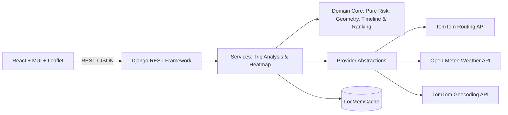

# StormRoute

> Weather-aware truck routing web app.

StormRoute evaluates long-haul truck routes across the contiguous United States against dynamic weather forecasts. It samples weather conditions along route corridors at the truck's estimated arrival time (ETA), evaluates risk thresholds against gross vehicle load weight, and recommends the safest, most efficient route.

---

## Key Features

- **Multi-Route Analysis**: Generates up to 3 distinct commercial truck route options with automatic via-waypoint diversification fallback.
- **Dynamic Weather Sampling**: Samples forecast weather conditions (wind, rain, snow) every 10, 25, or 50 miles at the truck's projected ETA at each checkpoint.
- **Cargo-Weighted Risk Classification**:
  - Classifies risk levels (*Low, Moderate, High, Severe, No Travel*) across sustained wind, rain, and snow rates.
  - Automatically elevates risk for heavy payloads (>30,000 lb and >40,000 lb) under high wind conditions.
- **Deterministic Recommendation Engine**: Lexicographically evaluates routes based on No Travel miles, Severe miles, High miles, average weighted risk score, and duration.
  > *Note*: Ranking follows the spec's priority order strictly; a small average-risk difference can choose a slower route, and the UI shows the time cost.
- **Corridor Weather Heatmap**: Interactive 0–48 hour forecast slider scrub across a 0.1° resolution corridor grid.
- **Interactive Map Console**: Clean, high-performance canvas map rendering with route polylines, risk-coded checkpoint markers, and inspector popups.

---

## System Architecture

StormRoute uses a strictly decoupled, layered architecture:



### Technology Stack

- **Backend**: Python 3.13, Django 5.2, Django REST Framework, HTTPX, Respx, Pytest.
- **Frontend**: React 19, Vite, TypeScript (strict), Material UI (MUI), Leaflet / React-Leaflet, TanStack Query.
- **External Providers**: TomTom Routing & Geocoding APIs, Open-Meteo Weather API, OpenStreetMap (OpenStreetMap public tiles, light use, attribution shown).

---

## Getting Started

### Prerequisites

- Python 3.10+
- Node.js 18+

### Backend Setup

```bash
cd backend
python -m venv .venv
source .venv/bin/activate  # Or on Windows: .venv\Scripts\activate
pip install -r requirements.txt

# Copy environment variables template
cp .env.example .env
# Edit .env with your TOMTOM_API_KEY

python manage.py migrate
python manage.py runserver
```

### Frontend Setup

```bash
cd frontend
npm install

# Copy environment variables template
cp .env.example .env

npm run dev
```

---

## Testing

```bash
# Backend unit & integration tests
pytest

# Frontend unit & component tests
npm test
```

---

## License

MIT
