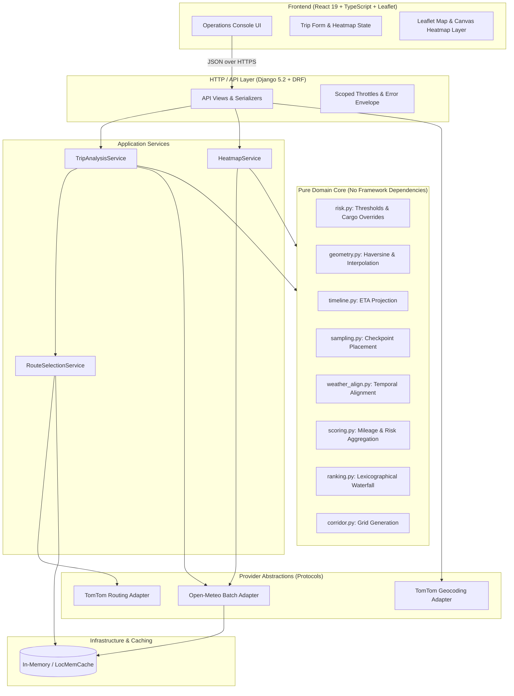

# StormRoute

A weather-aware commercial truck routing and risk assessment platform built with React and Django.

StormRoute evaluates long-haul commercial truck routes across the contiguous United States against forward-looking atmospheric forecasts. Instead of relying on static timestamps or simple traffic delays, the engine projects the truck's cumulative driving timeline, samples weather conditions along the corridor at each checkpoint's estimated arrival time (ETA), evaluates risk thresholds against gross vehicle weight, and delivers deterministic, explainable route recommendations.

---

## Live Deployment

- **Web Application (Vercel)**: [https://stormroute-a.vercel.app/](https://stormroute-a.vercel.app/)
- **Backend API (Render)**: [https://stormroute-api-0lnv.onrender.com/api/health/](https://stormroute-api-0lnv.onrender.com/api/health/)

---

## Table of Contents

- [Core Capabilities](#core-capabilities)
- [System Architecture](#system-architecture)
- [Domain Methodology & Rules Engine](#domain-methodology--rules-engine)
  - [Weather Risk Thresholds](#weather-risk-thresholds)
  - [Cargo Weight Overrides](#cargo-weight-overrides)
  - [Temporal Alignment & ETA Projection](#temporal-alignment--eta-projection)
  - [Checkpoint Mileage & Distance Conservation](#checkpoint-mileage--distance-conservation)
  - [Recommendation & Ranking Waterfall](#recommendation--ranking-waterfall)
- [REST API Reference](#rest-api-reference)
  - [POST /api/trips/analyze/](#post-apitripsanalyze)
  - [POST /api/trips/heatmap/](#post-apitripsheatmap)
  - [GET /api/geocoding/autocomplete/](#get-apigeocodingautocomplete)
  - [GET /api/health/](#get-apihealth)
- [Repository Structure](#repository-structure)
- [Local Development Setup](#local-development-setup)
  - [Prerequisites](#prerequisites)
  - [Backend Configuration](#backend-configuration)
  - [Frontend Configuration](#frontend-configuration)
- [Verification & Testing](#verification--testing)
- [Design System & Accessibility](#design-system--accessibility)
- [License](#license)

---

## Core Capabilities

- **Commercial Truck Routing with Fallback Diversification**: Queries TomTom routing using commercial truck profiles (`travelMode=truck`, 65 mph / 105 km/h commercial governor limit, continuous driving baseline). If the routing engine returns fewer than 3 qualifying alternative corridors, StormRoute dispatches parallel via-waypoint routing across diverse geometric coordinates to ensure 3 distinct options without synthetic route fabrication.
- **ETA-Synchronized Weather Sampling**: Distributes checkpoints along each route polyline at 10, 25, 50-mile or automatic intervals (auto-scaled by route length). Queries Open-Meteo for multi-coordinate hourly forecasts and evaluates wind speed, rain rate, and snowfall rate at the truck's exact projected arrival instant.
- **Cargo-Weighted Risk Matrix**: Evaluates wind, rain, and snow against mutually exclusive threshold boundaries. Applies gross vehicle weight overrides (>30,000 lb and >40,000 lb) to account for high-profile empty or semi-loaded trailer rollover susceptibility in high crosswinds.
- **Deterministic Recommendation Waterfall**: Ranks alternatives using a strict lexicographical priority order. Produces explainable recommendation headlines, identifying the exact deciding factor and the time delta compared to the fastest available route.
- **Corridor Weather Heatmap**: Precomputes a 49-frame hourly risk grid along the travel corridor (0 to 48 hours from departure). Rendered via an interactive timeline slider using a high-performance Leaflet canvas layer.
- **Operations Console Interface**: A responsive three-column dashboard with glassmorphic styling, elevation profiles, route comparison bar charts, metric distribution tables, and checkpoint inspection popups.

---

## System Architecture

StormRoute follows a strictly decoupled, layered architecture. The frontend handles state collection and rendering without business logic. Domain code consists entirely of pure Python functions and frozen dataclasses, completely isolated from framework, database, and network dependencies.



### Architectural Constraints

1. **Pure Domain Logic**: All calculations in `backend/core/domain/` are deterministic. Functions accept all inputs explicitly (including departure time and current time) with no system clock reads or database queries.
2. **Provider Isolation**: Third-party APIs sit behind abstract Python protocols (`RoutingProvider`, `GeocodingProvider`, `WeatherProvider`). Upstream vendor changes are isolated to individual adapter modules.
3. **Stateless Backend**: The application maintains no persistent user accounts or database sessions. Cached routing geometry and weather vectors use in-memory TTL caching.
4. **Display-Only Frontend**: The client application never calculates risk scores, interpolates ETAs, or alters route rankings. It renders server responses directly.

---

## Domain Methodology & Rules Engine

### Weather Risk Thresholds

Forecast variables are classified into five discrete risk levels: `low` (0), `moderate` (1), `high` (2), `severe` (3), and `no_travel` (4). Boundaries are lower-bound inclusive to ensure mutually exclusive categorization:

| Risk Level | Sustained Wind Speed (mph) | Rain Rate (in/hr) | Snowfall Rate (in/hr) |
|---|---|---|---|
| **Low** (0) | `< 25.0` | `< 0.10` | `< 0.50` |
| **Moderate** (1) | `25.0 <= w < 35.0` | `0.10 <= r < 0.25` | `0.50 <= s < 1.00` |
| **High** (2) | `35.0 <= w < 45.0` | `0.25 <= r < 0.50` | `1.00 <= s < 2.00` |
| **Severe** (3) | `45.0 <= w < 55.0` | `0.50 <= r <= 1.00` | `2.00 <= s <= 3.00` |
| **No Travel** (4) | `>= 55.0` | `> 1.00` | `> 3.00` |

*Note: Measurements are rounded before classification (wind to 1 decimal place, rain and snow to 2 decimal places) ensuring displayed values match their assigned risk category.*

### Cargo Weight Overrides

Wind risk increases significantly for commercial semi-trailers when operating light. StormRoute applies weight-based escalation rules:

- **Universal Shutdown**: Any sustained wind `>= 55.0 mph` escalates to **No Travel** regardless of cargo weight.
- **Lightweight High Wind (`> 30,000 lb` limit)**: Sustained wind between `45.0` and `54.9 mph` escalates to **No Travel** if total vehicle weight is `<= 30,000 lb` (i.e. empty or lightly loaded 53-foot dry van).
- **Moderate Crosswind Overhead (`> 40,000 lb` limit)**: Sustained wind between `35.0` and `44.9 mph` escalates to **Severe** if total vehicle weight is `<= 40,000 lb`.

Cargo rules can only elevate risk; they never decrease a base weather classification.

### Temporal Alignment & ETA Projection

Because weather fronts move dynamically, querying weather at a single fixed timestamp yields misleading risk profiles for long trips.

1. **Driving Timeline**: A piecewise linear timeline is constructed from TomTom instruction milestones, relating cumulative distance to elapsed driving time.
2. **Speed Governing**: Route travel times reflect a governed maximum commercial truck speed of 65 mph (105 km/h) under continuous driving conditions.
3. **Wind Interpolation**: Wind speed is instantaneous. The engine linearly interpolates forecast wind values between the two hourly timestamps bounding the checkpoint ETA.
4. **Precipitation Bucketing**: Rain and snow forecasts represent preceding-hour accumulation totals. The engine assigns the precipitation value from the hourly bucket containing the projected ETA:
   $$\text{bucket\_timestamp} = \lfloor\text{ETA}_{\text{hour}}\rfloor + 1\,\text{hour}$$

### Checkpoint Mileage & Distance Conservation

Checkpoints are placed at regular mile intervals (10, 25, 50, or Auto). To calculate risk miles without distortion:

- The first checkpoint (mile 0) governs the segment from mile 0 to half the distance to the second checkpoint.
- Intermediate checkpoints govern the segment extending from the midpoint of the preceding interval to the midpoint of the following interval.
- The destination checkpoint governs the segment from the midpoint of the final interval to the route terminus.

This ensures that the sum of miles across all risk categories exactly equals the total route distance:

$$\text{Miles}_{\text{Low}} + \text{Miles}_{\text{Moderate}} + \text{Miles}_{\text{High}} + \text{Miles}_{\text{Severe}} + \text{Miles}_{\text{No Travel}} = \text{Total Route Distance}$$

### Recommendation & Ranking Waterfall

Routes are evaluated and sorted using a deterministic lexicographical key:

```text
Sort Key: (
    has_no_travel_miles: bool,    # False (0) outranks True (1)
    no_travel_miles: float,       # Ascending
    severe_miles: float,          # Ascending
    high_miles: float,            # Ascending
    average_risk_score: float,    # Ascending (0.00 to 4.00)
    duration_seconds: int         # Ascending
)
```

1. **Safety First**: Any route with zero `No Travel` miles outranks all routes containing `No Travel` miles.
2. **Severe Exposure**: Routes with fewer `Severe` risk miles are prioritized.
3. **High Exposure**: Ties in severe mileage are resolved by minimizing `High` risk miles.
4. **Average Corridor Risk**: Remaining ties are resolved by the lowest distance-weighted average risk score.
5. **Travel Duration**: If two routes have identical weather risk profiles, the faster route is recommended.

The engine generates an explanation banner identifying the exact metric that broke the tie (e.g., *"Recommended because it avoids 42 miles of severe weather on Alternative 2, adding 28 minutes of travel time"*).

---

## REST API Reference

### POST `/api/trips/analyze/`

Evaluates up to 3 routes between origin and destination, calculating checkpoints, weather risk, and the recommended route.

#### Request Body

```json
{
  "origin": "Chicago, IL",
  "destination": "Denver, CO",
  "departure_time": "2026-10-15T08:00:00",
  "load_weight_lb": 35000,
  "sampling_interval_mi": 50
}
```

| Field | Type | Required | Description |
|---|---|---|---|
| `origin` | string | Yes | Origin address or placename (geocoded via TomTom). |
| `destination` | string | Yes | Destination address or placename. |
| `departure_time` | string | Yes | ISO 8601 local time at origin (`YYYY-MM-DDTHH:MM:SS`). |
| `load_weight_lb` | integer | Yes | Gross vehicle weight in pounds (`0` to `120,000`). |
| `sampling_interval_mi` | integer / null | No | Checkpoint spacing: `10`, `25`, `50`, or `null` for Auto. |

#### Response (`200 OK`)

```json
{
  "trip": {
    "origin": { "address": "Chicago, Illinois, USA", "lat": 41.8781, "lon": -87.6298 },
    "destination": { "address": "Denver, Colorado, USA", "lat": 39.7392, "lon": -104.9903 },
    "departure_time_utc": "2026-10-15T13:00:00Z",
    "departure_tz": "America/Chicago",
    "arrival_tz": "America/Denver",
    "load_weight_lb": 35000,
    "sampling_interval_mi": 50
  },
  "routes": [
    {
      "id": "route_0",
      "name": "I-80 W",
      "summary": {
        "distance_mi": 1004.2,
        "duration_seconds": 58320,
        "average_risk_score": 0.42,
        "miles_by_level": {
          "low": 854.2,
          "moderate": 150.0,
          "high": 0.0,
          "severe": 0.0,
          "no_travel": 0.0
        }
      },
      "geometry": [[41.8781, -87.6298], [41.8750, -87.6500]],
      "checkpoints": [
        {
          "index": 0,
          "mile": 0.0,
          "lat": 41.8781,
          "lon": -87.6298,
          "eta_utc": "2026-10-15T13:00:00Z",
          "eta_local": "2026-10-15T08:00:00-05:00",
          "weather": {
            "wind_speed_mph": 12.4,
            "rain_rate_in_hr": 0.0,
            "snow_rate_in_hr": 0.0
          },
          "risk": {
            "level": "low",
            "driving_factor": "wind"
          }
        }
      ]
    }
  ],
  "recommendation": {
    "recommended_route_id": "route_0",
    "deciding_factor": "fewest_severe_miles",
    "headline": "Recommended: Lowest weather risk corridor",
    "time_delta_vs_fastest_seconds": 0
  },
  "warnings": []
}
```

---

### POST `/api/trips/heatmap/`

Generates a precomputed 49-frame corridor risk tensor for the interactive weather forecast scrubber.

#### Request Body

```json
{
  "origin": "Chicago, IL",
  "destination": "Denver, CO",
  "departure_time": "2026-10-15T08:00:00",
  "load_weight_lb": 35000
}
```

#### Response (`200 OK`)

```json
{
  "grid": {
    "bounds": {
      "south": 39.5,
      "west": -105.2,
      "north": 42.2,
      "east": -87.4
    },
    "step_deg": 0.1,
    "rows": 28,
    "cols": 178
  },
  "hours": 49,
  "cells": [
    {
      "lat": 41.8,
      "lon": -87.6,
      "risk_by_hour": [0, 0, 1, 1, 2, 2, 0, 0]
    }
  ]
}
```

---

### GET `/api/geocode/`

Provides debounced geographic address completion via TomTom search.

- **Query Parameters**:
  - `q`: Search query string (minimum 3 characters, e.g. `?q=Chicago`).
- **Response**: Array of candidate objects with `label`, `lat`, and `lon`.

---

### GET `/api/health/`

Liveness and dependency connectivity probe.

- **Response (`200 OK`)**:
  ```json
  {
    "status": "ok",
    "timestamp": "2026-10-12T13:20:00Z"
  }
  ```

---

## Repository Structure

```text
StormRoute/
├── backend/
│   ├── api/                     # HTTP and REST framework layer
│   │   ├── serializers.py       # DRF input and response serializers
│   │   ├── views.py             # Route analysis and heatmap endpoints
│   │   ├── urls.py              # URL routing
│   │   ├── errors.py            # Standardized error envelope handlers
│   │   └── tests/               # API endpoint integration tests
│   ├── config/                  # Django configuration
│   │   ├── settings.py          # Environment settings, cache configuration
│   │   └── urls.py              # Root URL registry
│   ├── core/                    # Core application logic
│   │   ├── domain/              # Pure Python domain models and functions
│   │   │   ├── geometry.py      # Polyline sampling, haversine, simplification
│   │   │   ├── ranking.py       # Lexicographical route recommendation engine
│   │   │   ├── risk.py          # Weather threshold and load-weight evaluation
│   │   │   ├── rules_config.py  # Centralized threshold and constant definitions
│   │   │   ├── sampling.py      # Checkpoint spacing and placement
│   │   │   ├── scoring.py       # Segment mileage aggregation
│   │   │   ├── timeline.py      # Continuous driving ETA projection
│   │   │   ├── types.py         # Immutable dataclasses and enums
│   │   │   └── weather_align.py # Hourly forecast interpolation and bucketing
│   │   ├── services/            # Application service orchestrators
│   │   │   ├── trip_analysis.py # Multi-route analysis orchestrator
│   │   │   ├── route_selection.py # Route diversity and via-fallback logic
│   │   │   └── heatmap_service.py # Corridor grid risk precomputation
│   │   ├── providers/           # Third-party service adapters
│   │   │   ├── base.py          # Protocol abstractions
│   │   │   ├── routing_tomtom.py
│   │   │   ├── geocoding_tomtom.py
│   │   │   └── weather_openmeteo.py
│   │   ├── infra/               # Infrastructure adapters (Django cache wrapper)
│   │   └── tests/               # Domain and service unit test suites
│   ├── requirements.txt
│   └── manage.py
├── frontend/
│   ├── src/
│   │   ├── api/                 # API client and typed DTO interfaces
│   │   ├── components/          # Reusable UI components (RiskChip, RiskStrip)
│   │   ├── features/
│   │   │   ├── map/             # Leaflet canvas layers, radar, markers
│   │   │   ├── results/         # Route cards, comparison chart, checkpoints
│   │   │   └── trip-form/       # Autocomplete inputs, validation, controls
│   │   ├── hooks/               # Custom hooks (useTripAnalysis, useHeatmap)
│   │   ├── theme/               # Obsidian dark tokens and WCAG contrast rules
│   │   ├── utils/               # Display formatters
│   │   ├── App.tsx              # Operations console root shell
│   │   └── main.tsx
│   ├── package.json
│   └── vite.config.ts
├── docs/                        # Architecture and project specifications
└── README.md
```

---

## Local Development Setup

### Prerequisites

- **Python**: 3.10 or higher (Python 3.13 recommended)
- **Node.js**: 18.0 or higher
- **TomTom Developer Account**: API key for routing and geocoding services

---

### Backend Configuration

1. Navigate to the backend directory and set up a virtual environment:

   ```bash
   cd backend
   python -m venv .venv
   ```

2. Activate the virtual environment:

   - **Linux / macOS**:
     ```bash
     source .venv/bin/activate
     ```
   - **Windows (PowerShell)**:
     ```powershell
     .\.venv\Scripts\Activate.ps1
     ```

3. Install dependencies:

   ```bash
   pip install -r requirements.txt
   ```

4. Configure environment variables:

   ```bash
   cp .env.example .env
   ```

   Edit `.env` to include your TomTom API key:
   ```ini
   TOMTOM_API_KEY=your_tomtom_api_key_here
   DJANGO_DEBUG=True
   DJANGO_SECRET_KEY=local-dev-secret-key-change-in-prod
   ```

5. Run database migrations and launch the development server:

   ```bash
   python manage.py migrate
   python manage.py runserver 8000
   ```

   The backend API will be available at `http://localhost:8000/api/`.

---

### Frontend Configuration

1. Open a new terminal session and navigate to the frontend directory:

   ```bash
   cd frontend
   npm install
   ```

2. Configure environment variables:

   ```bash
   cp .env.example .env
   ```

   Ensure the backend API target matches your local server:
   ```ini
   VITE_API_BASE_URL=http://localhost:8000/api
   ```

3. Start the Vite development server:

   ```bash
   npm run dev
   ```

   Access the application in your browser at `http://localhost:5173/`.

---

## Verification & Testing

Both frontend and backend test suites are designed for offline execution using hermetic mocks and controlled weather fixtures.

### Backend Test Suite

The backend uses `pytest` with `respx` for mock HTTP execution. The suite verifies pure domain algorithms, load-weight override boundaries, distance conservation, and API serialization.

```bash
# Run the full backend test suite
cd backend
pytest

# Output: 554 passed in 6.92s
```

Key test coverage areas:
- `test_risk.py`: Boundary verification across all wind, rain, and snow transitions.
- `test_controlled_weather_scenarios.py`: Synthetic weather fixtures testing all load-weight overrides and lexicographical tie-break conditions.
- `test_route_selection.py`: Overlap calculation and via-waypoint diversification fallback.
- `test_weather_align.py`: Linear wind interpolation and precipitation bucket assignment.

### Frontend Test Suite & Linting

The frontend uses `vitest` and `@testing-library/react`.

```bash
cd frontend

# Run unit and component tests
npm test -- --run
# Output: 17 passed (17 files), 97 passed (97 tests)

# TypeScript typechecking
npx tsc --noEmit

# ESLint verification
npm run lint

# Production build validation
npm run build
```

---

## Design System & Accessibility

StormRoute uses an Obsidian dark console theme designed for logistics operations environments, avoiding high-glare surfaces while maintaining visual clarity.

### WCAG 2.1 AA Certified Contrast Ratios

All risk colors meet or exceed WCAG AA standards ($4.5:1$ contrast ratio for standard text) against dark container backgrounds:

| Level | Fill Color | Text Color | Verified Contrast Ratio |
|---|---|---|---|
| **Low** | `#3FA66B` | `#07171C` | **5.99:1** |
| **Moderate** | `#E2C044` | `#07171C` | **10.33:1** |
| **High** | `#E8872B` | `#07171C` | **6.91:1** |
| **Severe** | `#E5484D` | `#07171C` | **4.67:1** |
| **No Travel** | `#A78BFA` | `#07171C` | **6.72:1** |

---

## License

This project is licensed under the MIT License. See [LICENSE](LICENSE) for details.
