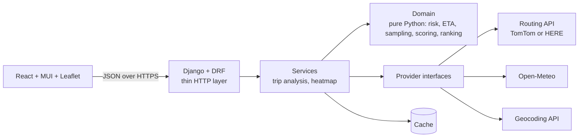

# ARCHITECTURE.md

Layers, services, data flow, module structure. Update after any structural change. Spec decisions (A-xx) live in PROJECT_CONTEXT.md §4.

---

## 1. System overview



Rules that follow from this picture:
- The UI shows and collects. It never classifies risk, computes ETAs or ranks routes.
- Views translate HTTP to service calls. No logic in views.
- Domain code is pure functions and frozen dataclasses. No Django, no HTTP, no clock reads (time is passed in).
- Providers hide third-party APIs behind interfaces. Swapping a vendor touches one file.
- There is no database use, no auth and no LLM. Django's default SQLite exists only because Django needs a database setting.

## 2. Repository layout

```
spotter-weather-routing/
  AGENTS.md  PROJECT_CONTEXT.md  ARCHITECTURE.md  CODING_RULES.md
  FEATURE_LOG.md  PROMPT.md  README.md  .gitignore
  .github/workflows/ci.yml            (optional, P7)
  backend/
    manage.py  requirements.txt  pyproject.toml (ruff, pytest)  .env.example
    config/                           Django project: settings.py, urls.py, wsgi.py
    api/                              HTTP layer (Django app)
      views.py  serializers.py  urls.py  errors.py  throttles.py  container.py
      tests/
    core/                             Business code. Django-free except core/infra/
      domain/
        types.py                      dataclasses and enums
        rules_config.py               ALL thresholds and constants
        risk.py                       classify, load rules, combine
        geometry.py                   haversine, along-polyline interpolation, simplify
        timeline.py                   distance -> elapsed-time interpolation
        sampling.py                   checkpoint placement, auto interval
        weather_align.py              pick/interpolate hourly values at an ETA
        scoring.py                    miles per level, average risk, route summary
        ranking.py                    lexicographic ranking and explanation
        corridor.py                   heatmap grid generation
      services/
        trip_analysis.py              orchestrator
        route_selection.py            dedupe, diversity, via-waypoint fallback
        heatmap_service.py
      providers/
        base.py                       Protocols + provider error types
        routing_<vendor>.py           chosen in P0
        geocoding_<vendor>.py
        weather_openmeteo.py
      infra/
        cache.py                      Cache Protocol + Django adapter (only place that imports Django cache)
      tests/                          mirrors the structure above
  frontend/
    package.json  vite.config.ts  tsconfig.json  .env.example
    src/
      main.tsx  App.tsx
      api/            client.ts, tripsApi.ts, geocodeApi.ts, types.ts, errors.ts
      features/
        trip-form/    TripForm.tsx, PlaceAutocomplete.tsx, validateTripForm.ts
        results/      RecommendationBanner.tsx, RouteCard.tsx, RouteList.tsx, CheckpointTable.tsx
        map/          MapView.tsx, RouteLayer.tsx, CheckpointLayer.tsx, HeatmapLayer.tsx,
                      HeatmapControls.tsx, MapLegend.tsx
      hooks/          useAnalyzeTrip.ts, useHeatmap.ts, useGeocodeSearch.ts, useDebouncedValue.ts
      components/     RiskChip.tsx, RiskStrip.tsx, ErrorAlert.tsx, EmptyState.tsx, LoadingSkeleton.tsx
      theme/          theme.ts, tokens.ts, riskColors.ts
      utils/          format.ts (display formatting only)
```

Do not add top-level folders or rename these without updating this file and logging a decision.

## 3. Domain model (core/domain/types.py)

All frozen dataclasses. Times are timezone-aware UTC `datetime`. Distances in miles inside the domain (conversion happens at the provider boundary). Durations in seconds.

- `Coordinate(lat, lon)`
- `RiskLevel` (IntEnum): LOW=0, MODERATE=1, HIGH=2, SEVERE=3, NO_TRAVEL=4
- `RiskDriver` (str enum): WIND, RAIN, SNOW, LOAD_RULE
- `Place(label, coordinate)`
- `TripRequest(origin, destination, departure_utc, origin_tz, load_weight_lb, interval_mode, interval_miles|None)`
- `RawRoute(provider_id, polyline: tuple[Coordinate], distance_miles, duration_seconds, timeline_points, via_summary|None)`
- `Timeline(points: tuple[(distance_miles, elapsed_seconds)])`, monotonic, at least 2 points
- `Checkpoint(index, mile, coordinate, covers_from_mile, covers_to_mile)`
- `WeatherSeries(cell, utc_offset_seconds, tz_name, wind_mph: Mapping[epoch,float], rain_in: ..., snow_in: ...)` hourly, keyed by epoch seconds
- `WeatherSample(wind_mph, rain_in_hr, snow_in_hr)` already rounded per A-03
- `RiskAssessment(level, table_level, driver, load_rule_applied, per_condition_levels)`
- `AssessedCheckpoint(checkpoint, eta_utc, tz_name, sample|None, assessment|None, reason: str|None)`
- `RouteSummary(distance_miles, duration_seconds, miles_by_level, unavailable_miles, avg_risk_score, max_level, unavailable_checkpoints)`
- `AnalyzedRoute(id, label, polyline, checkpoints, summary, rank, is_recommended)`
- `Recommendation(route_id, decided_by, headline, comparisons)`

## 4. Domain algorithms (exact behaviour, test every one)

### 4.1 Classification (`risk.py`)
`classify_wind(mph)`, `classify_rain(in_hr)`, `classify_snow(in_hr)` use thresholds from `rules_config.py` and the boundary convention in A-02. Inputs are already rounded (A-03).

`assess(sample, load_weight_lb) -> RiskAssessment`:
1. `per_condition = {wind, rain, snow}` levels.
2. `table_level = max(per_condition)`.
3. Load rules on the wind value `w` and load `L`:
   - `w >= 55` -> NO_TRAVEL (any load; already covered by the table)
   - `45 <= w < 55` and `L > 30000` -> NO_TRAVEL
   - `35 <= w < 45` and `L > 40000` -> at least SEVERE
4. `level = max(table_level, load_level)`. `load_rule_applied = level > table_level`.
5. `driver`: LOAD_RULE if `load_rule_applied`, else the condition with the highest level (tie order: wind, rain, snow). If `level` is LOW, driver is the highest condition anyway (used for display only).

Worked examples that must be tests:

| wind | rain | snow | load | expected level | driver |
|---|---|---|---|---|---|
| 20 | 0 | 0 | 50,000 | LOW | wind |
| 50 | 0 | 0 | 35,000 | NO_TRAVEL | load_rule |
| 50 | 0 | 0 | 30,000 | SEVERE | wind |
| 40 | 0 | 0 | 45,000 | SEVERE | load_rule |
| 40 | 0 | 0 | 40,000 | HIGH | wind |
| 56 | 0 | 0 | 0 | NO_TRAVEL | wind |
| 30 | 0.60 | 0 | 10,000 | SEVERE | rain |
| 20 | 0.25 | 0 | 10,000 | HIGH | rain |
| 10 | 1.00 | 0 | 10,000 | SEVERE | rain |
| 10 | 1.01 | 0 | 10,000 | NO_TRAVEL | rain |
| 10 | 0 | 3.00 | 10,000 | SEVERE | snow |
| 10 | 0 | 3.01 | 10,000 | NO_TRAVEL | snow |

Also parametrize every boundary: 24.9/25.0, 34.9/35.0, 44.9/45.0, 54.9/55.0 for wind, and the matching pairs for rain and snow.

### 4.2 Distance along the route (`geometry.py`)
- Cumulative distance on the full-resolution polyline with haversine.
- Scale the cumulative distances so the total equals the provider's reported distance (keeps miles consistent with the provider's summary).
- `point_at_mile(polyline, m)` interpolates linearly between vertices.
- `simplify(polyline, tolerance_m)` (Douglas-Peucker) is for the response geometry only. Checkpoints and distances always use the full polyline.

### 4.3 Timeline and ETA (`timeline.py`)
- `Timeline` holds `(distance, elapsed)` control points. The provider adapter supplies the finest granularity it can (per-instruction or per-segment). Fallback: two points `(0,0)` and `(total_distance, total_duration)` (constant average speed).
- `elapsed_at(mile)` is linear interpolation. Validation: monotonic non-decreasing, first point is `(0,0)`.
- `eta = departure_utc + elapsed_at(mile)`.

### 4.4 Checkpoints (`sampling.py`)
- `resolve_interval(mode, manual_miles, longest_route_miles)` per A-01.
- Miles: `0, S, 2S, ...` while `< D`, plus `D`. For each, `covers_from = (prev_mile + mile)/2`, `covers_to = (mile + next_mile)/2`, clipped to `[0, D]`; first covers from 0, last covers to D.

### 4.5 Weather alignment (`weather_align.py`)
Given an hourly series keyed by epoch seconds and a time `t` (UTC):
- Wind: `h0 = floor_hour(t)`, `h1 = h0 + 1h`. Linear interpolation between values at `h0` and `h1` by the fraction of the hour elapsed. If either is missing, return None.
- Rain and snow: value at timestamp `floor_hour(t) + 1h` (the bucket whose window `[h, h+1h)` contains `t`). Missing -> None.
- If any of the three is None, the checkpoint has no weather: `sample=None`, `risk=None`, flagged "forecast unavailable". Never substitute zero. Unavailable checkpoints are excluded from miles and average risk and counted in a warning.
- Round per A-03 after alignment.

### 4.6 Scoring (`scoring.py`)
- `miles_by_level`: sum `(covers_to - covers_from)` per level.
- `avg_risk_score = sum(level_score * covered_miles) / sum(covered_miles)` over assessed checkpoints.
- `max_level`, `has_no_travel`, `no_travel_miles`.
- `delta_vs_fastest_seconds = duration - min(durations)`.

### 4.7 Ranking (`ranking.py`)
Sort key (ascending):
```
(no_travel_miles > 0,            # routes without No Travel first
 round(no_travel_miles, 1),
 round(severe_miles, 1),
 round(high_miles, 1),
 round(avg_risk_score, 2),
 duration_seconds)
```
- Rank 1 is recommended. Ties after all keys: keep provider order (stable sort).
- `decided_by`: the first key where winner and runner-up differ: `no_travel`, `severe_miles`, `high_miles`, `avg_risk`, `travel_time`; `only_option` if there is one route.
- `headline` is template text built from the numbers, for example: "Route B has 0 Severe miles vs 34 on Route A. It is 42 min slower than the fastest route." Deterministic. No LLM.
- If every route has No Travel: recommend rank 1 and add warning code `NO_SAFE_ROUTE`.

### 4.8 Corridor grid (`corridor.py`)
Used by the heatmap (see §7). Pure function: routes in, list of grid cells out.
- `spacing = max(20 mi, route_miles / 60)` along each route.
- At each station add 3 points: on the route and +/- 12 mi perpendicular.
- Snap to the weather grid (0.1 degrees), deduplicate, cap at 250 cells (raise spacing until under the cap).
- All numbers live in `rules_config.py`.

## 5. Providers (core/providers/base.py)

Protocols (signatures; implementations are free to add private helpers):

```python
class RoutingProvider(Protocol):
    def get_routes(self, origin: Coordinate, destination: Coordinate,
                   via: Sequence[Coordinate] = (), max_routes: int = 3) -> list[RawRoute]: ...

class GeocodingProvider(Protocol):
    def search(self, query: str, limit: int = 5) -> list[Place]: ...

class WeatherProvider(Protocol):
    def get_series(self, cells: Sequence[GridCell]) -> dict[GridCell, WeatherSeries]: ...
    def get_timezone(self, coordinate: Coordinate) -> str: ...  # IANA name

class Cache(Protocol):
    def get(self, key: str) -> Any | None: ...
    def set(self, key: str, value: Any, ttl_seconds: int) -> None: ...
```

Provider rules:
- Every outbound call has a timeout (`HTTP_TIMEOUT_SECONDS`), at most one retry with short backoff on 429/5xx/timeouts, and raises only the typed errors below.
- Errors: `ProviderTimeout`, `ProviderRateLimited`, `ProviderBadResponse`, `ProviderUnavailable`, `NoRouteFound`. Never leak vendor URLs or API keys in messages. Set the `httpx` logger to WARNING (vendor keys sit in query strings).
- Weather provider: snap to the grid, check cache per cell, fetch missing cells in chunks (about 100 per request) in parallel with a thread pool, store per cell, return all. Request variables: `wind_speed_10m,rain,showers,snowfall` with `wind_speed_unit=mph`, `precipitation_unit=inch`, `timeformat=unixtime`, `timezone=auto`, `past_hours=3`, `forecast_hours=288`. Map results strictly by request array index (Open-Meteo guarantees request order; never compare float coords). Do not assert exact unit strings (API returns `mp/h`). Rain series = rain + showers, computed in the adapter.
- A fixed fetch window per cell is deliberate: it makes cached cells reusable by any later request.
- Routing provider: truck travel mode if supported. Return distance in miles and the best available timeline. Verify in P0 which fields give per-segment time.
- Composition root is `api/container.py`. Providers are built there from settings and passed into services. Nothing else reads settings or env vars.

## 6. Route selection (services/route_selection.py)

Goal: 3 distinct, sensible routes.
1. Ask the provider for up to 3 routes (or its max alternatives).
2. Drop duplicates and near-duplicates: a candidate is dropped if more than 85% of its length lies within 0.3 mi of a route already kept (grid-hash overlap check, 1 mi sampling).
3. Drop absurd detours: duration more than 1.6x the fastest.
4. If fewer than 3 remain, run the fallback: for anchors at 33% and 66% of the fastest route, offset perpendicular by `clamp(0.12 * route_miles, 15, 60)` miles to each side (+90° and -90°). Dispatch all 4 via-waypoint requests in parallel with a thread pool (origin -> via -> destination). Filter candidates by steps 2-3 (<85% overlap against all existing routes, <1.6x duration), and pick the lowest-overlap qualifying candidate to complete the 3 routes.
5. If still fewer than 3, return what exists plus warning `FEWER_THAN_3_ROUTES`.
6. Label routes A, B, C by ascending duration. A is the "Fastest" tag. Recommendation is separate.
Constants live in `rules_config.py`. Cache raw routes by `(origin, destination, via)` rounded to 4 decimals for `ROUTE_CACHE_TTL_SECONDS`.

## 7. Services

### TripAnalysisService.analyze(request) -> TripAnalysis
1. Resolve origin timezone (weather provider, cached by 1-degree cell for 24 h). Convert local departure to UTC (zoneinfo). Validate the time window.
2. Routes via route selection (cached).
3. Interval: resolve once for all routes.
4. Per route: timeline, checkpoints (domain).
5. Collect unique weather cells from all checkpoints. One call to the weather provider (batched, parallel, cached).
6. Per checkpoint: align weather at ETA, round, assess with load rules, attach local time (per-cell IANA tz).
7. Summaries, ranking, recommendation, warnings.
8. Return `TripAnalysis` (domain object). Serializers turn it into JSON.

### HeatmapService.build(request) -> Heatmap
1. Same validation and timezone step. Routes come from the route cache (re-fetched if missing).
2. `corridor.generate(routes)` -> cells (<= 250).
3. Weather for cells (shares the cache with analyze).
4. For `k` in 0..48: `t_k = floor_hour(departure_utc) + k h`. Per cell: align (same functions as 4.5) and assess with load rules. Store levels for overall, wind, rain, snow. Missing data -> null.
5. Return cells and 49 frames.

Concurrency: ThreadPoolExecutor in the weather provider only. Services stay sequential and simple.
Budget: total request time target under 6 s cold, under 1.5 s warm. Provider timeout 8 s. Hard cap on the whole request about 25 s.

## 8. API contract (api/)

Base path `/api/`. JSON, snake_case. GZip enabled. CORS allow-list from env. Throttled (`THROTTLE_ANALYZE`, plus a looser one for geocode).

| Method and path | Purpose |
|---|---|
| `GET /api/health/` | Liveness (used for uptime pings) |
| `GET /api/geocode/?q=` | Up to 5 places. `q` is 3 to 100 chars |
| `POST /api/trips/analyze/` | Routes, checkpoints, risk, recommendation |
| `POST /api/trips/heatmap/` | Corridor cells and 49 hourly frames |

**Request (analyze and heatmap, same serializer):**
```json
{
  "origin":      {"label": "Dallas, TX", "lat": 32.7767, "lon": -96.7970},
  "destination": {"label": "Denver, CO", "lat": 39.7392, "lon": -104.9903},
  "departure_local": "2026-10-12T08:00",
  "load_weight_lb": 42000,
  "interval": "auto"
}
```
`interval` is `"auto"`, `10`, `25` or `50`. Coordinates are range-checked. Origin and destination must differ by more than a small distance. `departure_local` is a naive local datetime at the origin.

**Analyze response (shape):**
```json
{
  "request": {"origin": {...}, "destination": {...}, "departure_utc": "...", "departure_local": "...",
              "origin_timezone": "America/Chicago", "load_weight_lb": 42000,
              "interval_miles": 25, "interval_mode": "auto"},
  "recommended_route_id": "route_b",
  "recommendation": {"route_id": "route_b", "decided_by": "severe_miles", "headline": "...",
                     "comparisons": [{"route_id": "route_a", "severe_miles": 34.0, "high_miles": 12.5,
                                      "avg_risk_score": 1.2, "duration_seconds": 40000}]},
  "routes": [{
    "id": "route_b", "label": "Route B", "tags": ["recommended"], "rank": 1, "via": "I-35 N, I-70 W",
    "distance_miles": 801.2, "duration_seconds": 44100,
    "departure_utc": "...", "departure_tz": "America/Chicago",
    "arrival_utc": "...", "arrival_local": "2026-10-13T08:15:00-06:00", "arrival_tz": "America/Denver",
    "geometry": [[32.7767, -96.797], ...],
    "summary": {"miles_by_level": {"low": 600.0, "moderate": 150.0, "high": 40.0, "severe": 0.0, "no_travel": 0.0},
                "avg_risk_score": 0.62, "max_level": "high", "has_no_travel": false,
                "delta_vs_fastest_seconds": 2520},
    "checkpoints": [{
      "index": 0, "mile": 0.0, "lat": 32.7767, "lon": -96.797,
      "eta_utc": "...", "eta_local": "2026-10-12T08:00:00-05:00", "local_tz": "America/Chicago",
      "covers_miles": [0.0, 12.5],
      "weather": {"wind_mph": 12.4, "rain_in_hr": 0.0, "snow_in_hr": 0.0},
      "risk": {"level": "low", "driver": "wind", "load_rule_applied": false, "reason": "..."}
    }]
  }],
  "warnings": [{"code": "FEWER_THAN_3_ROUTES", "message": "..."}],
  "meta": {"routing_provider": "...", "weather_provider": "open-meteo", "weather_cells": 94,
           "cache_hits": 40, "elapsed_ms": 3120}
}
```
`weather` and `risk` are `null` for a checkpoint with no forecast data.

**Heatmap response (shape):**
```json
{
  "start_utc": "...", "start_local": "...", "origin_timezone": "America/Chicago",
  "cells": [{"lat": 33.1, "lon": -97.0}, ...],
  "frames": [{"offset_hours": 0, "time_utc": "...", "time_local": "...",
              "overall": [0, 1, ...], "wind": [...], "rain": [...], "snow": [...]}, ...]
}
```
Level arrays have one int (0-4) or null per cell, same order as `cells`. 49 frames. Raw values are not sent (they live in checkpoint popups).

**Errors (one envelope, one place: `api/errors.py`):**
```json
{"error": {"code": "validation_error", "message": "...", "fields": {"load_weight_lb": ["..."]}}}
```

| Status | Code | When |
|---|---|---|
| 400 | `validation_error` | Bad or missing input, out-of-range values, departure outside allowed window |
| 422 | `no_route_found`, `beyond_forecast_horizon` | Input is valid but cannot be served |
| 429 | `rate_limited` | Our throttle |
| 502 | `upstream_error` | A provider returned garbage |
| 503 | `weather_unavailable`, `routing_unavailable` | A provider is down or out of quota |
| 504 | `upstream_timeout` | A provider timed out |
| 500 | `internal_error` | Anything else. Log it. Never return a traceback |

## 9. Caching

| What | Key | TTL | Note |
|---|---|---|---|
| Raw routes | rounded origin, destination, via | 30 min | Saves routing quota. Heatmap reads from here |
| Weather per cell | grid cell | 30 min | The most valuable cache. Shared by analyze and heatmap |
| Origin timezone | 1-degree cell | 24 h | |
| Geocode | lowercased query | 24 h | |

LocMemCache with one gunicorn worker (threads for concurrency). If more workers are ever used, caches are per process and still correct, just less effective. Add a per-key lock so concurrent identical requests do not double-fetch (optional, P6).

Quota math to keep in mind: Open-Meteo free allows 10,000 calls/day. A cold analyze plus heatmap is roughly 300-400 cells, so about 25 cold runs per day. The cache and the 0.1 degree grid are what make this workable. Tests must never hit live APIs.

## 10. Frontend architecture

**Component tree**
```
App
  AppShell (layout: side panel + map; stacked on mobile)
    TripForm (PlaceAutocomplete x2, departure picker, load weight, interval select, submit)
    ResultsPanel
      RecommendationBanner, WarningsList
      RouteList -> RouteCard (x3) -> CheckpointTable (collapsed)
    MapView
      TileLayer
      RouteLayer (3 polylines, selected one emphasized)
      CheckpointLayer (canvas circle markers, popups)
      HeatmapLayer + HeatmapControls (slider, play/pause, layer toggle, legend)
```

**State**
- Server state: TanStack Query. `useAnalyzeTrip` (mutation), `useHeatmap` (query, enabled after a successful analyze, same input), `useGeocodeSearch` (query, debounced 300 ms, min 3 chars).
- UI state: selected route id, heatmap on/off, hour index, layer. Local to the features that need it.
- Form state: local, validated by `validateTripForm` (light checks; the server is authoritative). Field errors from the API map back onto form fields.

**Map rendering and performance**
- `preferCanvas: true`. Checkpoints are `CircleMarker`, never DOM markers.
- Selected route's checkpoints drawn larger and with popups; others drawn as small dots.
- Response geometry is already simplified by the backend.
- Heatmap: `leaflet.heat` layer created once. On slider change, call `setLatLngs` on the existing layer from a precomputed per-frame array. No React re-render of the map, no network call. Throttle with `requestAnimationFrame`. Frames are converted to `[lat, lon, intensity]` arrays once when the response arrives.
- Intensity from level: Low faint, rising to No Travel strongest. Uniform grid spacing keeps the additive density of `leaflet.heat` from distorting values. If it still looks wrong, fall back to a custom canvas layer drawing one soft circle per cell colored by level (decision to be logged).
- The legend uses the same risk colors as the chips (`theme/riskColors.ts`, keyed by the level strings the API returns).

**UX states (all required):** idle with an example hint, validation errors under fields, analyze loading (skeletons), heatmap loading (disabled slider with spinner), API error with retry, empty/partial (fewer than 3 routes, missing weather), no-safe-route warning, slow-server banner if the first request takes more than 5 s.

**Responsive (DESIGN.md §5):**
- **>= 1440 px (three columns):** header 56 px. Left column 340 px (Trip form). Center: map fills remaining space. Right column 380 px (Results). Columns scroll internally; the page does not scroll.
- **900–1439 px (two columns):** left panel 400 px holds Trip form on top and Results below, scrolling internally. Map fills remaining space.
- **< 900 px (mobile):** header 48 px. Bottom tab bar with three tabs: Plan (Trip form), Map (map plus heatmap bar), Routes (Results). Touch targets at least 40 px. No horizontal scroll.

**Accessibility:** risk is always text plus color (chips with labels). Inputs have labels. Focus order follows visual order. Slider has an accessible value label with the local time.

## 11. Security

- Secrets only in env vars. `.env` in `.gitignore`. Only `.env.example` committed. No keys in the frontend; all vendor calls go through the backend.
- `DEBUG=False` in production, explicit `ALLOWED_HOSTS`, CORS allow-list (no wildcard), HTTPS only.
- DRF throttling on every public endpoint.
- Server-side validation of every input: coordinate ranges, string lengths, enum values, numeric ranges, departure window.
- Upstream errors are mapped to our error codes. Vendor bodies, URLs and keys never reach the client or logs.
- Minimal Django: drop admin, sessions and messages apps if unused.
- Dependencies: pin versions, lockfiles committed, run `pip-audit` and `npm audit` before submission.

## 12. Configuration

- `core/domain/rules_config.py`: thresholds, load rule limits, risk scores, auto-interval breakpoints, grid size, corridor constants, diversity constants, window sizes.
- Environment variables: PROJECT_CONTEXT §7, read in `config/settings.py` only.
- No magic numbers elsewhere.

## 13. Testing architecture

- `core/domain`: exhaustive unit tests, no mocks needed. Parametrize boundaries. Coverage goal 90%+.
- `core/services`: tests with fake providers (in-memory classes implementing the Protocols). Cover: 3 routes, fewer than 3 routes, missing weather at some checkpoints, all routes No Travel, interval auto, cache reuse.
- `core/providers`: tests with `respx` against recorded fixture JSON. Cover success, timeout, 429, malformed body, chunking, rain+showers math, unit handling.
- `api`: DRF client tests with a fake container. Cover validation errors, every status code in §8, throttling, response shape.
- `frontend`: Vitest for `validateTripForm`, formatters, heat frame conversion. React Testing Library for TripForm validation and results rendering with a mocked API.
- One manual live smoke script (`backend/scripts/live_smoke.py`), run by hand, sparingly.
- Fixtures in `tests/fixtures/`. Never commit real API keys in fixtures.

## 14. Deployment

```
Browser -> Vercel/Netlify (static React build)
        -> Render/Railway/Fly (gunicorn + Django, 1 worker, threads) -> Routing API, Open-Meteo, Geocoding API
```
- Backend: `gunicorn config.wsgi --workers 1 --threads 8 --timeout 60`. Env vars set in the host's dashboard.
- Free hosts that sleep add a cold start of up to about a minute. Mitigate: an uptime ping on `/api/health/` every 5 minutes, and the frontend's slow-server banner. Warm it up right before submitting and before recording the Loom.
- Frontend env `VITE_API_BASE_URL` points to the backend. Backend CORS allow-list contains the frontend origin.

## 14.1 Failure modes

| Failure | Behaviour |
|---|---|
| Routing returns 1-2 routes | Fallback (§6), else warning and fewer routes |
| Weather provider down or rate limited | 503 `weather_unavailable`, friendly message, cached cells still used when complete |
| Weather missing for some cells or hours | Those checkpoints marked unavailable, excluded from scoring, warning shown |
| Departure outside window | 400 with a field error stating the allowed range in origin local time |
| Trip extends past forecast window | 422 `beyond_forecast_horizon` |
| Same origin and destination | 400 field error |
| Geocode returns nothing | Empty list, UI shows "no matches" |
| Worker restarts | Caches empty, everything recomputes, still correct |

## 15. Extension points (not built, mention only in the README)

Gust-aware wind, temperature and ice, rest-stop and hours-of-service modeling, live traffic ETAs, departure-time suggestions when no safe route exists, Redis cache, saved trips.
